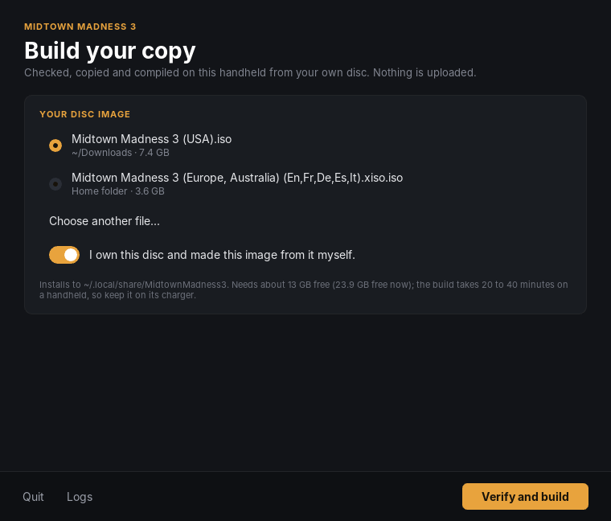
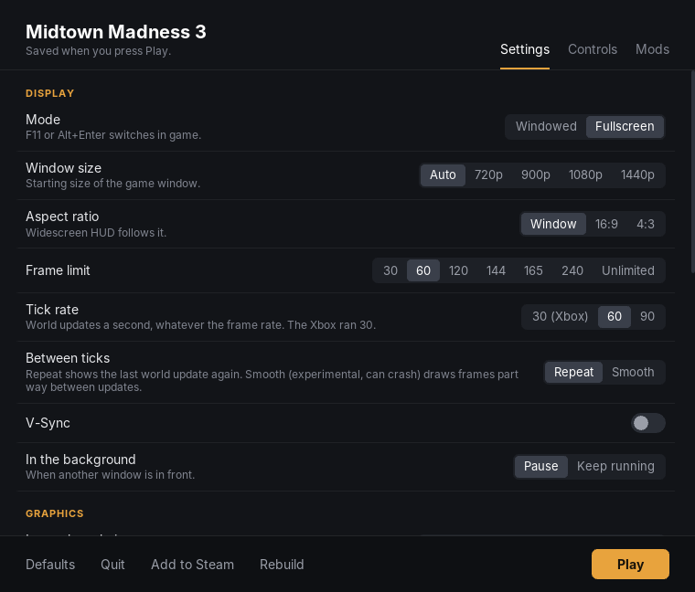

# mm3-recomp-arm64

Play [mm3-recomp](https://github.com/MattSG/mm3-recomp), the static
recompilation of the original Xbox *Midtown Madness 3*, natively on Snapdragon
handhelds running [ArmadaOS](https://armadaos.dev/), such as the Retroid
Pocket 6. No emulator: the game's code is translated to C and compiled for
ARM64, and the Xbox GPU is drawn with SDL3's GPU API on Vulkan.

  
  

The launcher builds the game on the handheld from your own disc. This
repository and its releases hold no part of the game ([LEGAL.md](LEGAL.md)).

## Install

You need a disc image of your own *Midtown Madness 3*: the USA redump ISO or
the Europe/Australia XISO. The build needs about 6 GB free on top of the
image's size.

1. In **Desktop Mode**, download `MidtownMadness3-Launcher-linux-arm64.tar.gz`
   from the [latest release](https://github.com/Ken5998/mm3-recomp-arm64/releases/latest),
   extract it to your home folder and start `MidtownMadness3/mm3-launcher`.
2. Pick your disc image (the launcher finds images in your home folder,
   Downloads, ROMs folders and SD card; **Choose another file...** for others),
   confirm that you own it and press **Verify and build**. Keep the handheld
   on its charger: the launcher checks the disc, copies the game's files,
   downloads its build tools, translates the game and compiles it, then
   starts the game once without a window to capture its audio programs and
   compiles again with them built in. This takes 30 to 60 minutes.
3. Press **Play**, or **Add to Steam** to start the game from Gaming Mode like
   any other game, with its artwork drawn from your disc.

The launcher keeps everything in `~/.local/share/MidtownMadness3` (the game,
its saves, the build tools and logs) and installs nothing on the system. If
[Pinyon Shift's ARM64 launcher](https://github.com/Ken5998/pinyon-shift-arm64)
is installed, the build reuses its LLVM instead of downloading it again.

When a new release is out, the launcher shows **Update to X** (**B** on the
controller): it downloads the release, checks it and replaces itself, then
asks you to **Build again** for the new version, reusing the game files it
already copied.

## Playing

- On ArmadaOS the handheld's controls reach the game when Steam starts it:
  use **Add to Steam** and start the game from Steam, in Gaming Mode or in
  Desktop Mode.
- The launcher's **Settings**, **Controls** and **Mods** are mm3-recomp's:
  display mode, frame limit, tick rate, widescreen, draw distance and the
  controller and keyboard bindings. The game remembers the language you pick
  in its own menu. On a handheld the game starts full screen at the screen's
  resolution.
- In the launcher: D-pad to move, **A** to change, **LB**/**RB** for tabs,
  **Start** to play, **X** to add to Steam, **B** to update the launcher
  when a new release is out, **Back** to quit.
- **F11** or **Alt+Enter** switches full screen in game.

## Status

Version 0.2.0 is rebuilt on mm3-recomp v2026.11.01.5.1, which draws with SDL3
on Vulkan instead of Direct3D 11 through DXVK, and compiles the game's audio
DSP programs ahead of time instead of interpreting them. The 0.1.x releases
ran races at 40-60 fps on a Retroid Pocket 6; 0.2.0 is new on the handheld,
so frame rate, audio and the hang some players saw when a second race loads
still need checking there. 0.2.2 makes the controller work. 0.2.3 gives each
vertex program its own shader again, as 0.1.5 did on the old renderer (the
first seconds stutter while they compile; later runs load them from
`~/.local/share/MidtownMadness3/cache/shaders`), and copies the saves of
0.1.x to where the new runtime looks for them. mm3-recomp itself is a work in progress, so expect
rough edges, and back up your saves (`~/.local/share/MidtownMadness3/saves`).

## If something goes wrong

The launcher shows which step failed. Its **Logs** link opens the build log,
and the game writes `~/.local/share/MidtownMadness3/logs/game.log`; attach
them to an [issue](https://github.com/Ken5998/mm3-recomp-arm64/issues).

## Developers

How the port works, how its patches are kept and how releases are made:
[docs/DEVELOPMENT.md](docs/DEVELOPMENT.md).

## License

GPL-3.0, as mm3-recomp. The patches modify mm3-recomp files under the GPL and
xboxrecomp files under their MIT and LGPL-2.1 licences; [NOTICE](NOTICE)
lists everything the launcher uses. None of this grants any rights to
*Midtown Madness 3* or Xbox software. This is an unofficial community project,
not affiliated with or endorsed by Microsoft, Xbox or the game's other rights
holders.
