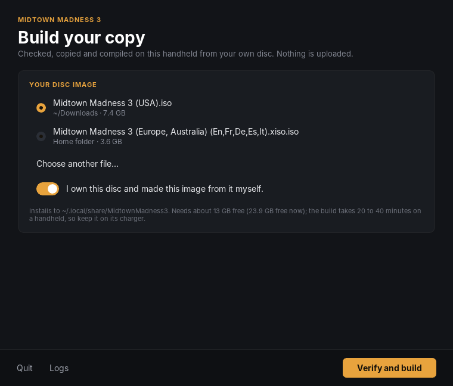
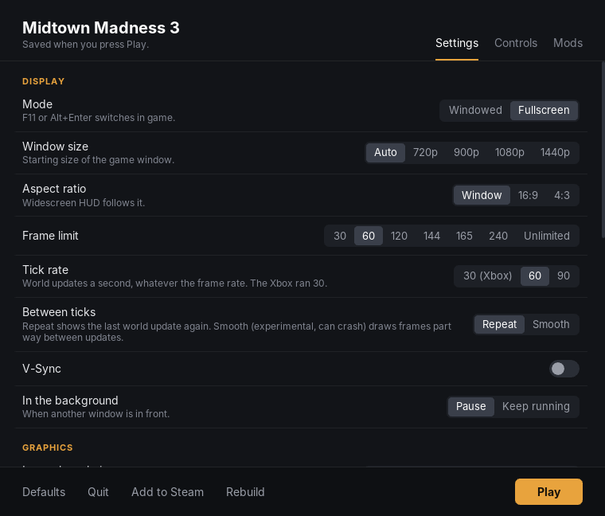

# mm3-recomp-arm64

Play [mm3-recomp](https://github.com/MattSG/mm3-recomp), the static
recompilation of the original Xbox *Midtown Madness 3*, natively on Snapdragon
handhelds running [ArmadaOS](https://armadaos.dev/), such as the Retroid
Pocket 6. No emulator: the game's code is translated to C and compiled for
ARM64, and its Direct3D renderer runs on Vulkan through DXVK.

  
  

The launcher builds the game on the handheld from your own disc. This
repository and its releases hold no part of the game ([LEGAL.md](LEGAL.md)).

## Install

You need a disc image of your own *Midtown Madness 3*: the USA redump ISO or
the Europe/Australia XISO. The build needs about 6 GB free on top of the
image's size.

1. In **Desktop Mode**, download `MidtownMadness3-Launcher-linux-arm64.tar.gz`
   from the [latest release](https://github.com/Ken5998/mm3-recomp-arm64/releases/latest),
   extract it to your home folder and start `MidtownMadness3/mm3-launcher`.
2. Pick your disc image (the launcher finds images in your home folder,
   Downloads, ROMs folders and SD card; **Choose another file...** for others),
   confirm that you own it and press **Verify and build**. Keep the handheld
   on its charger: the launcher checks the disc, copies the game's files,
   downloads its build tools, translates the game and compiles it, which takes
   20 to 40 minutes.
3. Press **Play**, or **Add to Steam** to start the game from Gaming Mode like
   any other game, with its artwork drawn from your disc.

The launcher keeps everything in `~/.local/share/MidtownMadness3` (the game,
its saves, the build tools and logs) and installs nothing on the system. If
[Pinyon Shift's ARM64 launcher](https://github.com/Ken5998/pinyon-shift-arm64)
is installed, the build reuses its LLVM instead of downloading it again.

## Playing

- On ArmadaOS the handheld's controls reach the game when Steam starts it:
  use **Add to Steam** and start the game from Steam, in Gaming Mode or in
  Desktop Mode.
- The launcher's **Settings**, **Controls** and **Mods** are mm3-recomp's:
  display mode, frame limit, tick rate, widescreen, draw distance and the
  controller and keyboard bindings. On a handheld the game starts full screen
  at the screen's resolution.
- In the launcher: D-pad to move, **A** to change, **LB**/**RB** for tabs,
  **Start** to play, **X** to add to Steam, **Back** to quit.
- **F11** or **Alt+Enter** switches full screen in game.

## Status

This is an early release of the port. On a Retroid Pocket 6 the launcher
builds the game in about 20 minutes and the game starts on its GPU (Turnip);
playing it through is still being tested. mm3-recomp itself is a work in
progress, so expect rough edges, and back up your saves.

## If something goes wrong

The launcher shows which step failed. Its **Logs** link opens the build log,
and the game writes `~/.local/share/MidtownMadness3/logs/game.log`; attach
them to an [issue](https://github.com/Ken5998/mm3-recomp-arm64/issues).

## Developers

How the port works, how its patches are kept and how releases are made:
[docs/DEVELOPMENT.md](docs/DEVELOPMENT.md).

## License

GPL-3.0, as mm3-recomp. The patches modify mm3-recomp files under the GPL and
xboxrecomp files under their MIT and LGPL-2.1 licences; [NOTICE](NOTICE)
lists everything the launcher uses. None of this grants any rights to
*Midtown Madness 3* or Xbox software. This is an unofficial community project,
not affiliated with or endorsed by Microsoft, Xbox or the game's other rights
holders.
